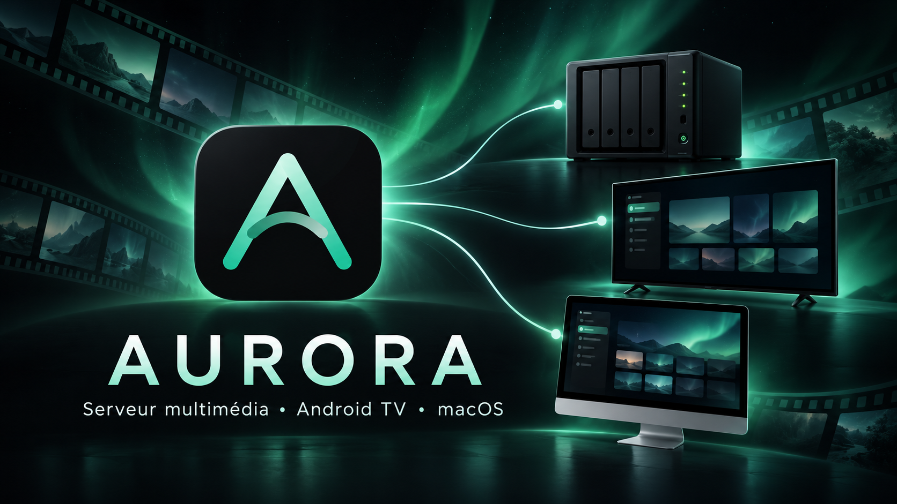
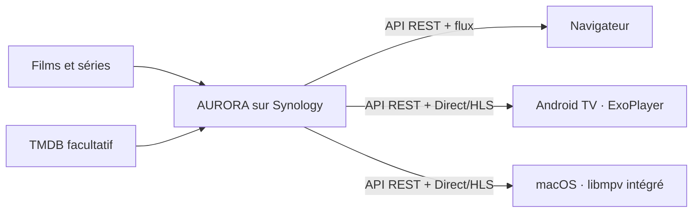
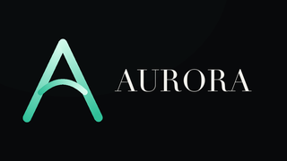

# AURORA

AURORA est une médiathèque personnelle auto-hébergée sur Synology DSM 7, accompagnée de lecteurs Android TV et macOS natifs. Aucun service cloud, abonnement ou compte externe n’est requis pour utiliser la médiathèque.

## Les trois composants

| Dossier | Version | Plateforme | Lecteur |
|---|---:|---|---|
| [`server/`](server/) | 0.1.8 | Synology DSM 7 x86-64 | Web, FFmpeg côté NAS |
| [`android-tv/`](android-tv/) | 0.1.0 | Android TV 7.0+ | Media3/ExoPlayer ; repli externe historique facultatif |
| [`macos/`](macos/) | 0.1.0 | macOS 15+, Intel et Apple Silicon | **libmpv intégré**, aucun VLC |

## Fonctionnalités

- bibliothèques films/séries par dossier, collections, favoris et liste à voir ;
- indexation incrémentale, métadonnées TMDB et affiches mises en cache ;
- profils, contrôle parental, progression et reprise multi-appareils ;
- Direct Play prioritaire, remux, puis conversion H.264/HLS si nécessaire ;
- pistes audio, sous-titres, chapitres et épisode suivant ;
- association d’un appareil par code sur `http://<nas>:8890/link` ;
- administration, diagnostics, sauvegarde et restauration sur le NAS.

> La connexion utilise un **compte AURORA**, pas le compte Synology DSM.

## Architecture



Le serveur choisit Direct Play, remux ou conversion selon les capacités annoncées par le client. Les mots de passe et cookies ne sont jamais placés dans les URL. Les sessions macOS sont conservées dans le Trousseau ; Android utilise AndroidKeyStore.

## Installation rapide

1. Construire et installer le paquet Synology : [`docs/INSTALLATION.md`](docs/INSTALLATION.md#serveur-synology).
2. Ouvrir `http://<ip-du-nas>:8890`, créer l’administrateur AURORA et ajouter les dossiers médias.
3. Installer le client voulu : [Android TV](docs/INSTALLATION.md#android-tv) ou [macOS](docs/INSTALLATION.md#macos).
4. Saisir l’adresse du NAS. Le port `8890` est ajouté automatiquement.
5. Se connecter avec le compte AURORA ou valider le code affiché sur `/link`.

## Documentation

- [Installation complète](docs/INSTALLATION.md)
- [Architecture et sécurité](docs/ARCHITECTURE.md)
- [Serveur : guide utilisateur](server/docs/GUIDE_UTILISATEUR.md)
- [Serveur : maintenance et sauvegarde](server/docs/MAINTENANCE.md)
- [Serveur : tests](server/docs/TESTS.md)
- [Android TV : utilisation et télécommande](android-tv/README.md)
- [macOS : build, DMG et limites](macos/README.md)
- [Politique de sécurité](SECURITY.md)

## Développement

```bash
# Serveur
cd server && go test ./...

# Android TV
cd android-tv && ./gradlew :app:testDebugUnitTest :app:assembleDebug

# macOS
cd macos && xcodegen generate
xcodebuild -project AURORA.xcodeproj -scheme AURORA -destination 'platform=macOS' test
```

Les builds, bases, journaux, clés, `local.properties`, préférences et médias personnels sont exclus du dépôt. Les binaires de livraison sont publiés séparément comme artefacts/releases.

## Statut et licence

Projet personnel en développement. Le code AURORA n’a pas encore de licence open source publique : tous droits réservés. Les composants tiers conservent leurs licences propres ; le client macOS embarque les notices LGPL de MPVKit/libmpv/FFmpeg.


